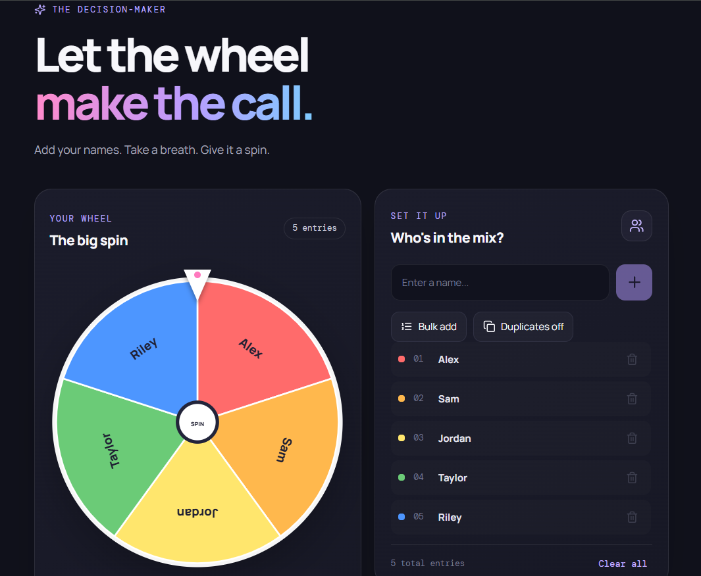
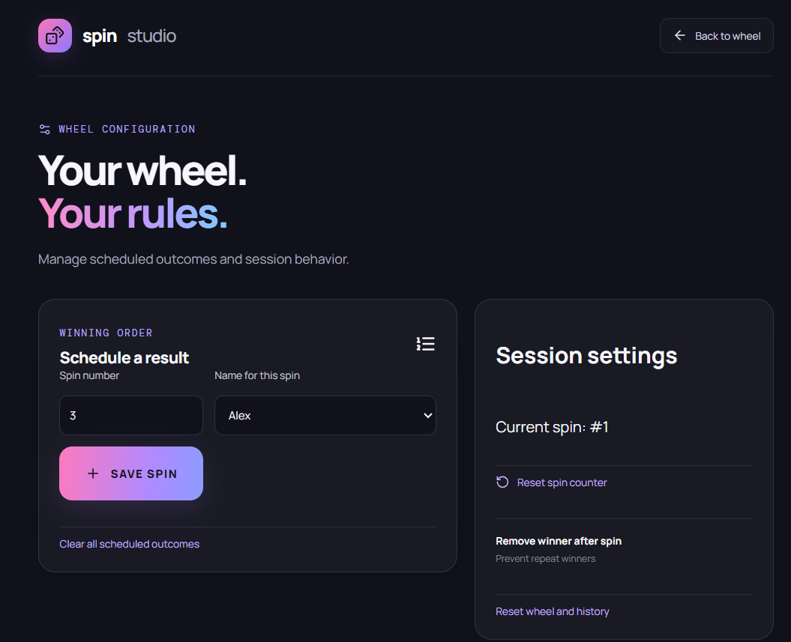
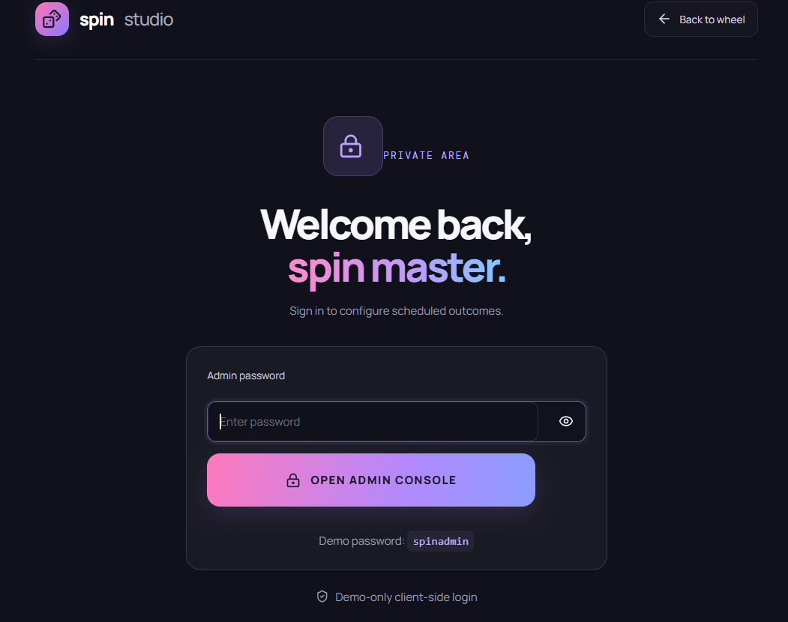

# 🎯 Result-Predefined Spin Wheel

A configurable spin wheel application featuring **presettable outcomes** and an administrative interface for controlling the results.

Unlike a conventional random spin wheel, this application allows authorized configuration of predetermined outcomes through an admin console.

## ✨ Key Features

* 🎡 **Interactive Spin Wheel** — A visual, interactive wheel experience.
* 🎯 **Presettable Results** — Configure the outcome a spin will produce.
* ⚙️ **Admin Console** — Manage and configure wheel outcomes.
* 🎨 **Custom Interface** — Designed for a straightforward user experience.
* 🌐 **Live Deployment** — Hosted using Firebase.

## 🛠️ Tech Stack

* React
* JavaScript
* CSS
* Vite
* Firebase Hosting

## 🚀 Live Demo

[Open the Live Application](https://spinstudiowheel.web.app)

## 💡 Project Purpose

This project explores configurable interactive experiences, UI development, and application logic through a spin wheel interface with administrator-controlled outcomes.

## 👨‍💻 Author

**Ajmal Kariyadan**

* GitHub: [@ajmalkariyadan](https://github.com/ajmalkariyadan)
* LinkedIn: [Connect with me](https://www.linkedin.com/in/ajmalkariyadan)

  ---

## 📸 Application Screenshots

### 🎡 Spin Wheel Interface

### ⚙️ Admin Console

### 🔐 Admin Login

